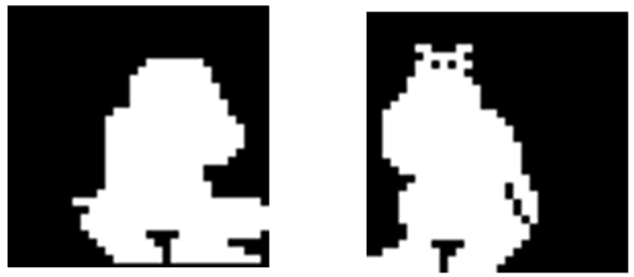
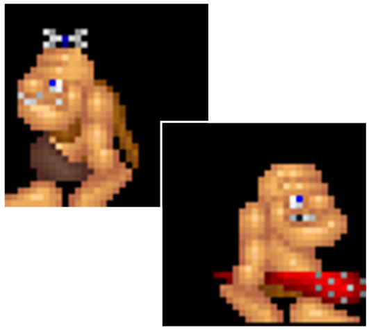
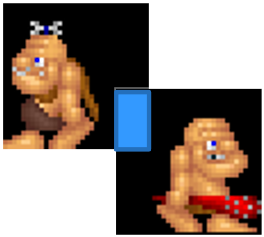
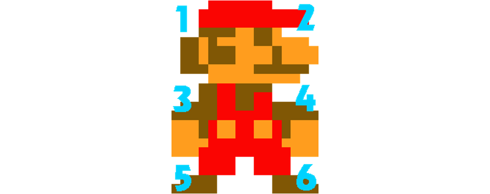

# Introduction

---

## Previously

- Vectors.
- ECS Intro.

---

## This Week

- Milestone 3.
- Collisions in general.
- Pixel Perfect Collisions.

---

## Progress

- We are happy with the progress being made in the practical sessions
- You are learning loads!
- It will feel like you are lost in a tangle of code - that is normal - you
  can untangle as you go (refactoring).
- Don't get put off by the size of the tasks, divide and conquer!
- **Note**: see possible structure diagram.

---

# Milestone 3

---

## Milestone 3

- For this milestone you need to show your engine structure can support a full
  2D game. This should meet the following requirements:
   - Realisation of an entity,
   - Pixel Perfect Collisions OR Colliders,
   - World system.
- The 1st and 3rd are the same really, just need an
  entity held in a world class .
- Quite a lot to do, will need a lot of code rearrangement from `main` into
  `world`.
- But the result is a solid foundation for your game demo.

---

# Collision detection

---

## Collision detection

- How do we know when two objects collide?
- What does it mean for two sprites to overlap?
- Does every overlap need to count as a collision?

**Goal:** Explore different collision detection strategies.

---

## Collision detection vs response

#### Detection

- Determine whether two objects overlap.

#### Response

- Decide what happens after a collision.
- Stop movement, deal damage, destroy an object, etc.

Today: Focus on detection.

---

## Method 1: Distance

Treat objects as circles.

- Store a centre and a radius.
- Compare the distance between centres.
- Collide if `distance < radiusA + radiusB`.

Useful for:

- Circular objects.
- Simple gameplay interactions.

---

## Circle collision in c++

```cpp
float dx = a.x - b.x;
float dy = a.y - b.y;

float distanceSq = dx * dx + dy * dy;
float radiusSum = a.radius + b.radius;

bool collision =
    distanceSq < radiusSum * radiusSum;
```

- No square root required.
- Fast and simple.

---

## Method 2: axis-aligned bounding boxes

An AABB is a rectangle.

- Defined by position, width, and height.
- No rotation.
- Check whether the rectangles overlap.

Useful for:

- Platforms.
- Walls.
- Characters.
- Broad collision detection.

---

## AABB in SFML

SFML provides `getGlobalBounds()`.

```cpp
sf::FloatRect a = spriteA.getGlobalBounds();
sf::FloatRect b = spriteB.getGlobalBounds();
bool collision = a.findIntersection(b).has_value();
```

- Simple to implement.
- Works with transformed sprites.
- Available in SFML 3.

**Note:** SFML 2 uses a different intersection API.

---

## The problem with bounding boxes

Consider a sprite shaped like a ring.

- Its bounding box is a rectangle.
- Much of that rectangle is empty.
- Another object can overlap the empty space.

The engine reports a collision.

But should the game?

---

## Method 3: smaller collision shapes

Use shapes that better fit the object.

- Circles.
- Rectangles.
- Multiple simple shapes.

Examples:

- A capsule for a character.
- A circle for a ball.
- Several rectangles for a complex object.

Often a better choice than pixel-perfect detection.

---

## Collision shapes vs sprites

A sprite is a visual representation.

A collision shape represents gameplay.

They do not have to match exactly.

Examples:

- A sword has a dedicated hitbox.
- A character has a simple body shape.
- A tree has a narrow trunk collider.

**Visual accuracy is not always gameplay accuracy.**

---

## What about transparent pixels?

A texture may contain transparent pixels.

For example:

- A character with a large empty margin.
- A circular object inside a square image.
- A sprite with transparent gaps.

Should transparent pixels cause collisions?

A bounding box cannot answer this question.

---

## What is pixel-perfect collision?

Compare the actual pixels covered by two sprites.

- Find their overlapping screen regions.
- Map the overlap to each sprite's texture.
- Check whether both pixels are opaque.

A collision occurs when both pixels satisfy the chosen opacity rule.

This can produce a more accurate visual match.

---

## Pixel Perfect Collisions

- To determine pixel perfect collisions, we need to
   - Initially carry out a rectangle collision test
   - Determine the collision rectangle in both colliders
   - Step through the rectangles (they must be the same size) and compare
     alpha values
- A potentially more efficient way may be to
   - Do a pre-process of textures determining a collision mask
   - Can be packed into a bitfield with `0=passable` and `1=solid`
   - This was the original way used but it is a bit of a pain doing the
     packing and unpacking and probably has negligible performance gain
     nowadays



---

## Pixel Perfect

- Given this scenario



- *After* doing the basic rectangle test, determine the rectangle of
  collision:
  - This will be in screen space.

---

- Transform it into each entities' texture space:
  - Simply translate by - entity position.
  - Consider any frame offset as different frames will have different
    collision areas.



---

## Pixel Perfect

- Then work out start offsets and line offsets
- Then loop through both areas
- As soon as both have a transparency above a cut off then a collision has
  occurred:
    - E.g. transparency of > 10 = collision - can tweak to taste

---

## Ingredients

- We will need:
    - To know the frame rectangle for both sprite at a particular frame number
      using a particular frame set
    - To be able to translate these to screen space and generate an
      intersection rectangle
    - Be able to read the raw texel data of the image
    - To be able to map this intersection rectangle into the texture space and
      get an offset into the image
    - Traverse both images checking when both pixels have an alpha value over
      a set amount

---

## Expanded

- To work out the intersection rectangle you can
   - Extract left as the maximum of the two, right as the minimum
   - Top as the max and bottom as the min
- Possible rectangle functions:
   - Rectangle

   ```cpp
   GetIntersectionWith(const Rectangle &other)
   Translate(int dx, int dy)
   ```
- To get access to the raw pixel data in SFML:
  - Create an `sf::Image` type and load the texture into that
    - Best do at load time (same time you are loading a texture)
  - Can then access the raw texels via:

  ```cpp
  Image::GetPixelsPtr
  ```
  - It returns an array of bytes with 4 bytes per texel (RGBA)

---

## Alpha and transparency

An RGBA pixel contains:

- Red
- Green
- Blue
- Alpha

Alpha represents opacity.

Common values:

- `0`: Fully transparent.
- `255`: Fully opaque.

A basic collision test can ignore pixels with alpha `0`.

---

## The basic pixel test

For overlapping pixels:

```cpp
bool opaqueA = alphaA > 0;
bool opaqueB = alphaB > 0;

if (opaqueA && opaqueB)
{
    // Pixel-perfect collision
}
```

But where do `alphaA` and `alphaB` come from?

And how do we find corresponding texture pixels?

---

## Finding the overlap

First, calculate the intersection of the sprites' bounds.

- No intersection? No collision.
- Intersection found? Continue.

Only examine pixels inside the overlap.

This is much cheaper than comparing every pixel in both images.

---

## From world coordinates to texture coordinates

A screen pixel does not necessarily correspond directly to a texture pixel.

Consider:

- Sprite position.
- Sprite origin.
- Sprite scale.
- Sprite rotation.
- Texture rectangle.
- Texture atlas offsets.

A robust implementation must account for these transformations.

---

## The easy case: untransformed sprites

Start with a restricted implementation.

Assume:

- No rotation.
- Scale is `(1, 1)`.
- No unusual origin.
- A known texture rectangle.

Then mapping screen coordinates to texture coordinates is straightforward.

Extend the implementation later.

---

## Reading pixel data in SFML

SFML textures can provide access to their underlying image data.

```cpp
sf::Image image = texture.copyToImage();

sf::Color pixel = image.getPixel(x, y);

bool opaque = pixel.a > 0;
```

Important:

- Pixel access requires valid coordinates.
- Avoid copying the texture for every collision test.
- Prepare and cache pixel data instead.

---

## Cache the alpha data

Reading pixels repeatedly is expensive.

Instead:

- Extract alpha values once.
- Store them in a reusable array.
- Query the array during collision checks.

For example:

```cpp
std::vector<sf::Uint8> alpha;
```

In SFML 3, use the appropriate byte type for your version.

---

## The cost of pixel-perfect collision

Imagine two large sprites overlapping.

The engine may need to inspect thousands of pixels.

With many objects, the cost grows quickly.

Questions:

- How many pairs need testing?
- How large is each overlap?
- Can we reject collisions earlier?

---

## Broad phase and narrow phase

Split collision detection into two stages.

#### Broad phase

- Quickly identify possible collisions.
- Use bounding boxes or circles.

#### Narrow phase

- Perform a more precise test.
- Use pixel-perfect collision only when needed.

This avoids unnecessary pixel comparisons.

---

## Platformer Collisions

- With platform games you need to know the direction of travel when
  determining collisions
- One method is to use several different points on the entity to test for
  collision e.g.:



---

## Animated sprites

An animated sprite changes its texture rectangle over time.

Each frame may have:

- Different transparent regions.
- Different visible shapes.
- Different bounding boxes.

A collision test based on the wrong frame can produce incorrect results.

---

## Which frame should we test?

Suppose a character swings a sword.

- The sword is absent in one frame.
- The sword extends outward in another.
- The character's visual silhouette changes.

Possible approaches:

- Test the current animation frame.
- Use a dedicated hitbox for the sword.
- Use a fixed collision shape for the character.

Choose according to gameplay needs.

---

## Animation and texture atlases

A texture atlas stores multiple frames in one texture.

Each sprite uses a texture rectangle to select its frame.

When checking pixel transparency:

- Use the correct frame rectangle.
- Convert to the correct atlas coordinates.
- Do not read pixels from a neighbouring frame.

---

## A hidden problem: visual vs gameplay timing

Animation and collision do not always need to match pixel by pixel.

Examples:

- A sword hits slightly before its animation reaches the target.
- A character remains vulnerable during a dodge animation.
- A projectile has a larger hitbox than its visible pixels.

**Collision rules are part of game design.**

---

## Alternative: dedicated hitboxes

Define collision geometry separately from the artwork.

Examples:

- A rectangle around the character's torso.
- A circle around a projectile.
- A polygon around a weapon.

For animation:

- Enable hitboxes during specific frames.
- Move or resize them as required.

This often gives better gameplay control.

---

## Alternative: per-frame masks

Precompute a binary mask for each animation frame.

Each pixel records:

- `0`: Transparent.
- `1`: Solid.

During collision detection:

- Select the current frame's mask.
- Check the overlapping pixels.
- Stop when a solid pixel pair is found.

Memory and processing costs increase with image size and frame count.

---

## Optimizing pixel-perfect tests

Possible optimizations:

- Reject non-overlapping bounding boxes.
- Cache alpha masks.
- Stop at the first opaque pixel pair.
- Use smaller collision masks.
- Check only relevant object pairs.

Start with a correct implementation before optimizing.

---

## Choosing the right method

| Method             | Best Use                 |
| ---                | ---                      |
| Distance           | Circular objects         |
| AABB               | Fast general checks      |
| Simple shapes      | Predictable gameplay     |
| Pixel-perfect      | Irregular silhouettes    |
| Dedicated hitboxes | Precise gameplay control |

No single method is best for every game.

---

## Designing a reusable engine

Avoid putting collision code directly into every entity class.

Consider a collision interface:

```cpp
class Collider
{
public:
    virtual bool intersects(
        const Collider& other) const = 0;
    virtual ~Collider() = default;
};
```

Possible implementations:

- `CircleCollider`
- `BoxCollider`
- `PixelCollider`

The engine can use different collision strategies for different objects.

---

## Avoiding unnecessary complexity

Do not force every collider into one complicated class.

Prefer:

- Small, focused implementations.
- Clear collision rules.
- Shared utility functions.
- Explicit handling of supported transformations.

Add more advanced features only when required.

---

## Final questions

- Is pixel-perfect collision always more accurate?
- Does visual accuracy guarantee good gameplay?
- What happens when sprites rotate?
- How should animation affect collision?
- Which methods should a reusable engine support?

**Choose the simplest method that meets the game's requirements.**

---

# Conclusion

---

## We discussed

- Milestone 3
- Collisions

---

## Next time

- Explosions and bullets

---

## Any questions?

**Tutor**: Julien Cordry

**Email**: j.cordry@tees.ac.uk

**Office**: G0.46B

See Blackboard for online materials:
[[**https://bb.tees.ac.uk**]{.underline}](https://bb.tees.ac.uk)
