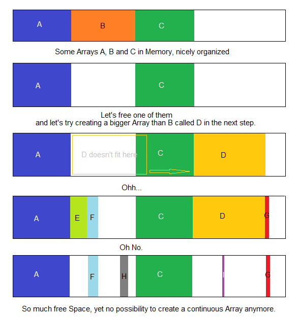
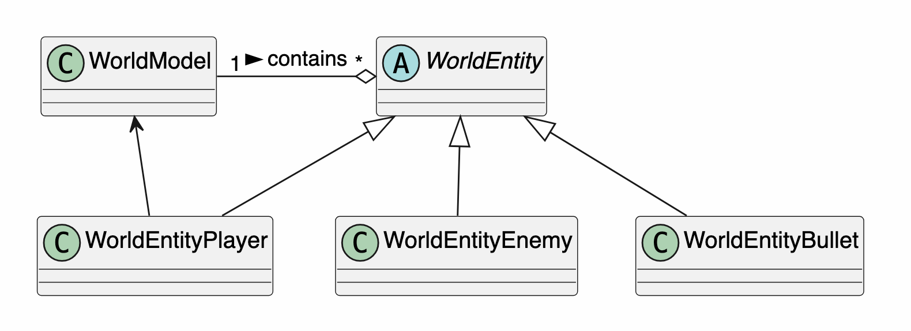
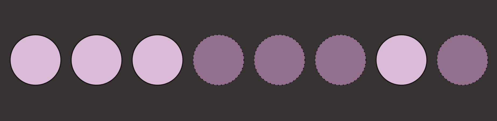
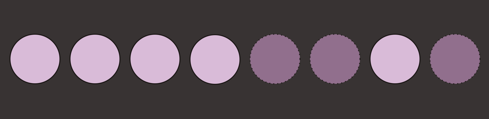
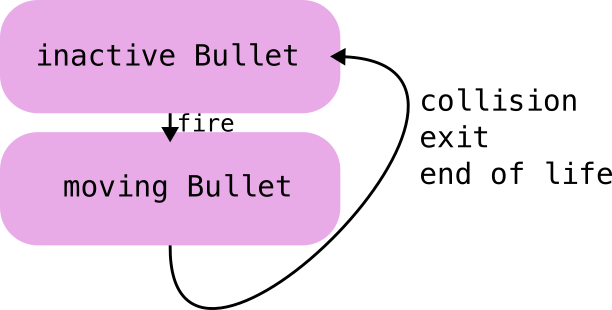

# Introduction

---

## Previously

- Last time
  - Pixel Perfect Collisions
  - Entity Component System

---

## Today

- Shooting & Exploding Methods
- Object Pooling
- Milestone deadline was this week

---

# Bullets

---

## Bullets

- How might we implement bullets?
- What are their characteristics?

---

## Generally

- Bullets are fired from
   - Player craft
   - Enemy craft
- The bullet will
   - Appear / spawn at a point on the firing entity
   - Travel at a set speed in the direction the entity is facing
- Deletion
   - If the bullet leaves the screen, it can be 'deleted'
   - If it collides with an enemy entity, it will take damage and be deleted,
     and an explosion spawned

---

## Dynamic allocation

- We could:
   - Use *new* to create a bullet entity when needed and
   - Use *delete* to delete it when it is considered dead
- What problems might there be doing this?
   - Allocating and deleting memory during the game loop can cause big
     slowdowns (depends on the OS what will happen)
- What solutions could we use?
   - Write our own memory manager - hard work
   - Pre-create a set of bullets

---



---

## Object pool

- We can add a flag to our entity base class called `alive`
  - This flag is `true` if the entity is '`alive`' otherwise it is `false`
    - When updating or carrying out collisions etc. we ignore all entities
      that are not alive
- When firing a bullet, we choose the next bullet that is not alive
- This requires us to
  - create a predefined number of bullets in advance and
  - remember the range of ids corresponding to these bullets

---

## Firing

- To fire:
  - Loop through all bullet entities
  - As soon as we find a bullet that is not alive
    - Mark it as alive
    - Set its start position and direction
    - Set its side (the same as the entity firing it)
  - If all bullets are in use, we cannot fire!
- Optionally bullets can have
  - Different speeds
  - Different graphics
  - Different collision costs
- These attributes would be provided by the firing entity at the time of
  spawning a bullet

---

## Fire & forget

- By using the capabilities of C++, the bullet can be initialised by the firer
  - Carry out its own movement
  - Carry out its own collisions etc.
- Once it has been fired the firing entity can forget about it

---

## Bullet

- Add a bullet entity to our world
  - A child of Entity
- In its update function move forward and check for going off the screen
  - If off the screen mark as inactive
  - Move forward by adding to a normalised direction vector * speed (as described earlier)

---

# Explosions

---

## Explosions

- Let's face it: we like blowing things up!
- Once an entity's health goes below zero, we need to kill it
  - Mark it as inactive via the flag
  - Spawn an explosion at its position
- What explodes is up to you:
  - Bullets, enemy entities and the player all explode on death
  - You can have different explosion animations for each

---

## Explosions

- An explosion is just a set of frames e.g.
- Do a Google and you should find some
- Even some explosion creator free utilities available
- The animation plays once and then the explosion is finished

---

## Explosions

- Add an explosion entity
- In the update check if finished the animation
  - If it has then mark as inactive
- As with bullets it is most efficient to create a set number of explosion
  entities in advance
  - Remember the range
  - Allocate from this range when required
- Again: always let the entity handle its own behaviour

---

## Design

- Bullets and Explosion management is best kept in the world model
- You will have a `FireBullet` function in World
  - You will need to remember the range and can create the bullet or explosion on request
  - You could create a manager class to manage this
  - But how to access `FireBullet` from a child entity?

---

## Code smells

- If the world class has a fire bullet function, then the instance of that
  class needs to be available to child entities



---

## Other approaches

- Use an event system
- Removes close dependencies
- Can be tricky to debug
- More on these later...

---

# Code considerations

---

## Should bullets extend `Entity`?

**Usually, yes.** If `Entity` represents objects managed by the game world.

```cpp
class Entity {
public:
    virtual ~Entity() = default;

    virtual void update(float dt) = 0;
    virtual void draw(sf::RenderWindow& window) = 0;

    sf::Vector2f position;
    bool active = true;
};
```

- Common interface for all game objects.
- The engine can manage different entity types uniformly.

---

## Specialising entities

A bullet adds projectile-specific behaviour.

```cpp
class Bullet : public Entity {
public:
    void update(float dt) override;
    void draw(sf::RenderWindow& window) override;

    sf::Vector2f velocity;
    float lifetime = 2.0f;
};
```

- `Entity` provides common properties.
- `Bullet` implements movement and lifetime.
- Other entities define their own behaviour.

**Alternative:** Use composition when objects share features but not behaviour.

---

## What is an object pool?

An object pool creates objects once and reuses them.

Instead of repeatedly creating and destroying bullets:

1. Preallocate bullets.
1. Activate one when firing.
1. Deactivate it when destroyed.
1. Reuse it for the next shot.

**Benefit:** Reduces repeated memory allocations.

---

## Bullet pool


---


## Bullet pool



---


## Bullet pool



---

## Creating a bullet pool

Store a fixed number of bullets in a vector.

```cpp
class BulletPool {
    std::vector<Bullet> bullets;

public:
    BulletPool(size_t capacity)
        : bullets(capacity) {}
};
```

All bullets exist from the beginning, but only active bullets participate in gameplay.

---

## Acquiring a bullet

Find an inactive bullet when the player fires.

```cpp
Bullet* acquire() {
    for (auto& b : bullets) {
        if (!b.active) {
            return &b;
        }
    }
    return nullptr;
}
```

---

Usage:

```cpp
if (Bullet* b = pool.acquire()) {
    b->position = spawnPosition;
    b->velocity = shotVelocity;
    b->lifetime = 2.0f;
    b->active = true;
}
```

- Returns an available bullet.
- Returns `nullptr` if the pool is full.

---

## Deactivating bullets

When a bullet expires or hits an enemy, deactivate it.

```cpp
void Bullet::update(float dt) {
    if (!active) return;

    position += velocity * dt;
    lifetime -= dt;

    if (lifetime <= 0)
        active = false;
}
```

No deletion is required. The bullet can be reused.

**Important:** Reset all relevant properties when reactivating an object.

---

## Updating and drawing

Only active bullets need updating and rendering.

```cpp
for (auto& b : bullets) {
    if (b.active)
        b.update(dt);
}

for (auto& b : bullets) {
    if (b.active)
        b.draw(window);
}
```

Collision detection must also ignore inactive bullets.

---

## What if the pool is full?

Suppose all 100 bullets are active.

A new shot cannot acquire a bullet.

Possible policies:

- Reject the shot.
- Expand the pool.
- Recycle an existing bullet.

**Engine design:** Make the policy explicit rather than silently losing objects.

---

## A generic object pool

Use a C++ template to reuse the pool implementation.

```cpp
template <typename T>
class ObjectPool {
    std::vector<T> objects;

public:
    ObjectPool(size_t capacity)
        : objects(capacity) {}
};
```

Usage:

```cpp
ObjectPool<Bullet> bullets(100);
ObjectPool<Explosion> explosions(20);
```

Each type must provide a suitable activation and reset mechanism.

---

## Managing explosions

Explosions also have a lifecycle:

1. Spawn at the impact position.
1. Play the animation.
1. Deactivate when finished.
1. Reuse the explosion object.

An explosion pool can work just like a bullet pool.

---

## Suggested engine architecture

Keep responsibilities separate.

- `Entity`: Common interface and state.
- `Bullet`: Projectile movement and lifetime.
- `Explosion`: Animation and lifetime.
- `ObjectPool<T>`: Reuses objects.
- `World`: Coordinates updates and collisions.

---

## When should you use a pool?

#### Useful when

- Objects are created frequently.
- Many objects coexist.
- Allocation overhead matters.

#### Not always necessary when

- There are few objects.
- Objects are created infrequently.
- Ordinary containers perform well enough.

#### Start simple

Profile before adding complexity.

---

## Separate update and collision detection

Keep the game loop easy to understand.

1. Process input.
1. Spawn objects.
1. Update movement.
1. Detect collisions.
1. Remove or deactivate objects.
1. Draw the scene.

---

## Collision detection: broad and narrow phases

Checking every pair of objects costs $O(n^2)$.

For many objects, use two phases:

- **Broad phase:** Find potentially colliding pairs.
- **Narrow phase:** Test those pairs precisely.

Start with bounding boxes. Optimise only when necessary.

---

## Spatial partitioning

Spatial partitioning reduces the number of collision checks.

Possible algorithms:

- Uniform grid: Divide the world into cells.
- Quadtree: Subdivide crowded regions.
- Spatial hash: Map positions to grid buckets.

#### Recommendation

Start with a uniform grid for a simple 2D game

---

> Remember the factory pattern?

---

## Object pool vs. Factory

These patterns solve different problems.

- **Factory:** Creates and configures an object.
- **Object pool:** Reuses existing objects.
- **Constructor:** Initialises a newly created object.

A factory can acquire an object from a pool and configure it.

---

## Composition over inheritance

Avoid building a deep hierarchy of specialised entities.

Instead, combine simple reusable features:

- Transform: position and rotation.
- Velocity: movement.
- Collider: collision shape.
- Lifetime: automatic expiry.
- Animation: visual effects.

Use inheritance when a shared interface is useful; use composition when features need to be mixed independently.

---

## Observer pattern: collision events

Objects should not need to know every other object type.

A collision system can emit an event:

```
struct CollisionEvent {
    EntityId first;
    EntityId second;
};
```

Systems can respond by applying damage, spawning explosions or playing sounds.

#### Benefit

Reduces coupling between collision detection and game-specific behaviour.

---

## Strategy pattern: different behaviours

Different bullets may need different movement algorithms.

Examples:

- Straight projectile.
- Homing missile.
- Sine-wave projectile.

Encapsulate movement in interchangeable behaviours when this flexibility is useful.

```
class MovementBehavior {
public:
    virtual ~MovementBehavior() = default;
    virtual void update(Bullet& b, float dt) = 0;
};
```

---

## State machines for object lifecycles

An object may have several states:

- Inactive
- Active
- Exploding
- Finished

A state machine makes valid transitions explicit.

For a simple bullet, a boolean may be sufficient. Use a state machine when behaviour becomes more complex.

---



---

## Fixed time step simulation

Physics and collision detection can behave inconsistently when update intervals vary significantly.

A fixed time step runs simulation updates at a constant interval.

```
while (accumulator >= fixedDt) {
    world.update(fixedDt);
    accumulator -= fixedDt;
}
```

Rendering can run independently of the simulation.

#### Explore

Fixed time step with an accumulator

---

## Keep the architecture proportional

Not every pattern is worth introducing immediately.

| Problem              | Start with     | Upgrade when needed |
| --------             | --------       | --------            |
| Object creation      | Constructors   | Factory             |
| Frequent allocation  | Vector         | Object pool         |
| Collision checks     | Bounding boxes | Spatial grid        |
| Different behaviours | Simple methods | Strategy            |
| Object state         | Boolean        | State machine       |
| Object communication | Direct calls   | Events              |

#### Guiding principle

Introduce abstractions to solve a real problem, not simply to use a design pattern.

---

# Conclusion

---

## We discussed

- Bullets
  - Pools
- Explosions

---

## Next time

- Virtual Worlds

---

## Any questions?

**Tutor**: Julien Cordry

**Email**: [[***j.cordry@tees.ac.uk***]{.underline}](mailto:j.cordry@tees.ac.uk)

**Office**: G0.46B

See Blackboard for online materials:
[[***https://bb.tees.ac.uk***]{.underline}](https://bb.tees.ac.uk)