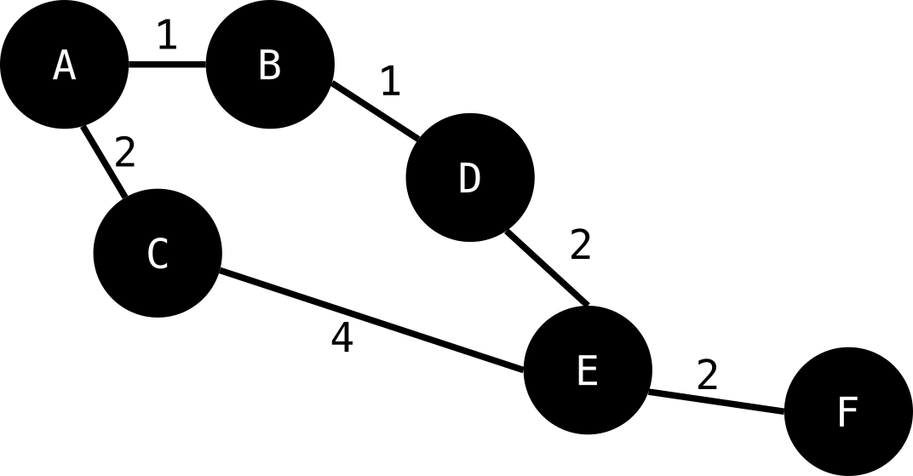
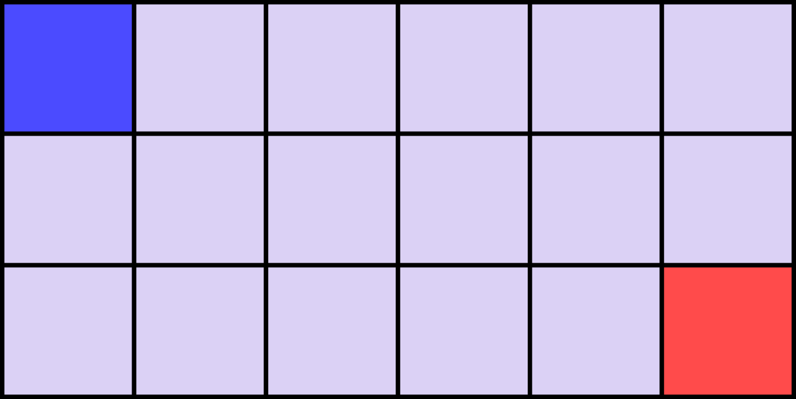
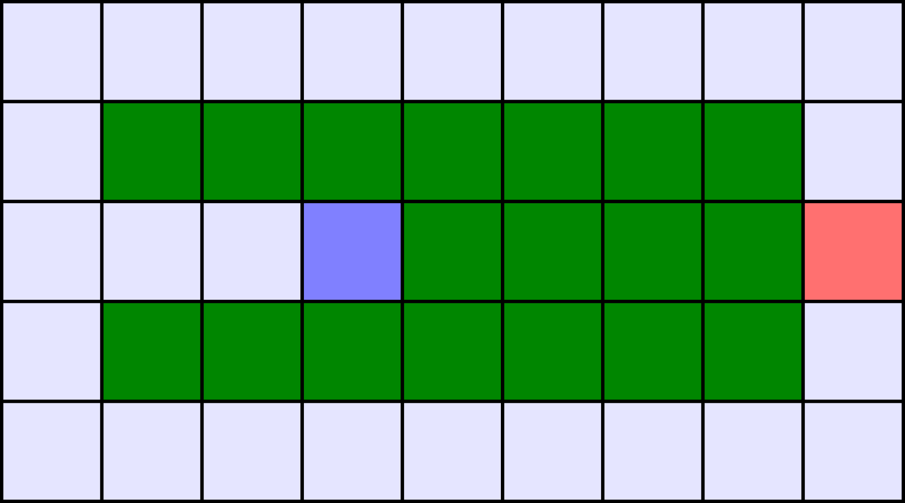

# Introduction

---

## Last time

- Virtual worlds
- Scrolling
- Pathfinding

---

## Today

- Pathfinding:
  - $A^{\star}$.
  - Comparison to other algorithms.
  - Complexities and possible solutions.

---

# Introduction to pathfinding

---

## What is pathfinding?

- Find a route between two positions.
- Avoid obstacles and impassable areas.
- Minimise the cost of travelling.
- Common in RTS, RPGs and platformers.

---

## Why do games need it?

- NPC movement.
- Enemy AI.
- Unit navigation in RTS games.
- Dynamic obstacle avoidance.
- Moving through complex environments.

---

## From maps to graphs

- Pathfinding operates on graphs.
- A graph contains nodes and edges.
- Nodes represent possible positions (`Tile` on a tiled map).
- Edges represent possible movements.
- Edges can have different costs.
- Each node represents a location.
- Each edge connects two reachable locations.
- Neighbours are accessible nodes.
- The graph describes possible movement.


---



---

## Movement costs

- Moving between nodes has a cost.
- Different terrain can have different costs.
- Diagonal movement can cost more.
- Dangerous areas can have higher costs.
- Some edges can be forbidden.

Example:

| Movement               | Cost     |
| ---                    | ---:     |
| Normal tile            | 1        |
| Difficult terrain      | 3        |
| Very difficult terrain | 5        |
| Impassable terrain     | Infinity |

---

# Breadth First Search (BFS)

---

## Remember BFS

- In which direction does it search?
- Any disadvantage of BFS?

---

## BFS: strengths and weaknesses

**Advantages**

- Simple to implement.
- Guarantees the shortest path in number of edges.
- Good for unweighted graphs.

**Disadvantages**

- Ignores movement costs.
- Explores many unnecessary nodes.
- Not ideal for large game maps.

---


---

## BFS complexity

- Time complexity: $O(V + E)$.
- $V$ = Number of nodes.
- $E$ = Number of edges.
- Memory complexity: $O(V)$.

**Problem:** What happens when the map becomes very large?

---

# Dijkstra's algorithm

---

## What if movement has a cost?

- Not all movements are equal.
- Some terrain is slower to cross.
- Some routes are more dangerous.
- We want the cheapest path, not necessarily the shortest.

---

## Dijkstra's algorithm

- Finds the lowest-cost path.
- Considers the cumulative cost from the start.
- Explores the cheapest known node first.
- Uses a priority queue.

---

## Dijkstra: the algorithm

1. Set start $cost$ to $zero$.
1. Set all other $costs$ to $infinity$.
1. Add start to $priority$ $queue$.
1. Extract the cheapest node.
1. Relax its outgoing edges.
    - Examine a neighbour.
    - Calculate a new possible cost.
    - Compare it with the existing cost.
    - Update if the new cost is lower.
    - Record the parent node.
1. Repeat until goal is reached.

---

## Dijkstra: strengths and weaknesses

**Advantages**

- Finds the optimal path.
- Supports different movement costs.
- Works on weighted graphs.

**Disadvantages**

- Explores in every direction.
- Can explore large areas unnecessarily.
- Can be expensive for large maps.

---

## Dijkstra complexity

- $V$ = Number of nodes.
- $E$ = Number of edges.
- Time complexity: $O((V + E) log(V))$.
- Priority queue determines exploration order.
- Memory complexity: $O(V)$.

**Key question:** Can we guide the search towards the goal?

---

# Greedy Best First Search

---

## Introducing heuristics

- Estimate the distance to the goal.
- Do not need to calculate the exact distance.
- Use an approximation.
- Call this estimate a *heuristic*.

---

## What is a heuristic?

A function estimating the remaining cost to the goal.

```
h(n) = Estimated cost from n to goal
```

Common heuristics:

- Manhattan distance (Taxi cab distance).
- Euclidean distance.
- Chebyshev distance (Chess king movements).

---

## Manhattan distance

Suitable for four-directional grid movement.

```cpp
h(n) = abs(x1 - x2)
     + abs(y1 - y2)
```

- Measures horizontal and vertical distance.
- Does not allow diagonal shortcuts.
- Useful for tile-based games.

---

## Euclidean distance

Suitable for free movement or diagonal movement.

```
h(n) = sqrt(dx*dx + dy*dy)
```

- Measures straight-line distance.
- Allows diagonal shortcuts.
- Useful for continuous movement.

---



---

## Greedy Best First Search

- Uses the heuristic to guide exploration.
- Always explores the node closest to the goal according to $h(n)$.
- Ignores the cost already spent.
- Uses a priority queue.

```

```

> Any idea why that might not be optimal?

---

## Greedy Best First Search: strengths and weaknesses

**Advantages**

- Often explores fewer nodes.
- Can find a path quickly.
- Easy to understand.

**Disadvantages**

- Ignores movement costs.
- Can choose expensive routes.
- **Does not guarantee the optimal path**.
- Can be misled by obstacles.

---

## The greedy problem

Consider two possible routes:

- Route A: Very close to the goal, but extremely expensive.
- Route B: Initially moves away from the goal, but is much cheaper.

Greedy Best First Search may choose Route A.

---



---

# $A^{\star}$: combining the best of both worlds

---

## Introducing $A^{\star}$

- Combines Dijkstra and Greedy Best First Search.
- Considers the cost already spent.
- Estimates the cost remaining.
- Balances efficiency and optimality.

---

## The $A^{\star}$ formula

$$
f(n) = g(n) + h(n)
$$

Where:

- $g(n)$: Actual cost from start to node.
- $h(n)$: Estimated cost from node to goal.
- $f(n)$: Estimated total path cost.

**Choose the node with the lowest $f(n)$.**

---

## Understanding the formula

- Dijkstra uses $g(n)$.
- Greedy uses $h(n)$.
- $A^{\star}$ uses both.
- Neither progress nor estimated distance is ignored.

---

## $A^{\star}$ data structures

Each node needs:

- Position.
- G cost.
- H cost.
- F cost.
- Parent node.

Additional structures:

- Open set: Nodes waiting to be explored.
- Closed set: Nodes already explored.
- Priority queue: Selects the lowest F cost.

---

## The $A^{\star}$ algorithm

1. Initialise the start node.
1. Add it to the ***open set***.
1. Select the node with the lowest $F$ cost.
1. If it is the goal, reconstruct the path.
1. Otherwise, examine its neighbours.
1. Calculate their tentative *G* costs.
1. Update cheaper routes and parents.
1. Repeat.

---

## $A^{\star}$ in pseudocode


```cpp
openSet.add(start)
while (!openSet.empty())
{
    current = lowestF(openSet)
    if (current == goal)
        return reconstructPath(current)
    openSet.remove(current)
    closedSet.add(current)
```

---

```cpp
    for (neighbour : getNeighbours(current))
    {
        newG = current.g + cost(current, neighbour)
        if (newG < neighbour.g)
        {
            neighbour.parent = current
            neighbour.g = newG
            neighbour.f = neighbour.g + neighbour.h
            openSet.add(neighbour)
        }
    }
}
```

---

## Reconstructing the path

- Start from the goal node.
- Follow parent pointers backwards.
- Stop when reaching the start.
- Reverse the resulting sequence.

---

## Complexity of $A^{\star}$

### Very dependent on the heuristic!

---

## Why does $A^{\star}$ find an optimal path?

- Depends on the heuristic.
- The heuristic must not overestimate the remaining cost.
- Such a heuristic is called *admissible*.
- With appropriate graph search handling, $A^{\star}$ finds an optimal path.

**Important:** A poor heuristic can make $A^{\star}$ behave much like Dijkstra.

---

## Choosing a heuristic

| Movement         | Heuristic |
| ---              | ---       |
| Four directions  | Manhattan |
| Eight directions | Octile    |
| Free movement    | Euclidean |

- The heuristic must match movement rules.
- It must not overestimate the actual remaining cost.

---

## The importance of heuristic quality

- Weak heuristic: Explores many nodes.
- Strong admissible heuristic: Explores fewer nodes.
- Overestimating heuristic: May lose optimality.
- Heuristic design directly affects performance.

---

# Implementing $A^{\star}$ in C++ and SFML

---

## Representing a node

```cpp
struct Node
{
    int x, y;

    float g;
    float h;
    float f;

    Node* parent;
};
```

- Position identifies the tile.
- G, H and F store path costs.
- Parent reconstructs the path.

---

## Representing the map


```cpp
class Grid
{
public:
    int width;
    int height;

    std::vector<std::vector<Node>> nodes;

    bool isWalkable(int x, int y);
    std::vector<Node*> getNeighbours(Node* node);
};
```

- Store nodes in a 2D structure.
- Identify valid neighbours.
- Reject obstacles and out-of-bounds positions.

---

## The priority queue

- Select the node with the lowest F cost.
- Use [[***`std::priority_queue`***]{.underline}](https://en.cppreference.com/cpp/container/priority_queue).
- Custom comparator.
- Avoid sorting the entire open set every iteration.

---

# Comparing algorithms in games

---

## Comparing the algorithms


| Algorithm   | Uses Costs | Uses Heuristic | Optimal          |
| ---         | ---        | ---            | ---              |
| BFS         | No         | No             | Yes (unweighted) |
| Dijkstra    | Yes        | No             | Yes              |
| Greedy      | No         | Yes            | No               |
| $A^{\star}$ | Yes        | Yes            | Yes*             |

*Assuming an appropriate admissible heuristic and correct implementation.*

---

## Comparing exploration

- BFS explores uniformly in all directions.
- Dijkstra explores according to accumulated cost.
- Greedy explores towards the goal.
- $A^{\star}$ balances accumulated and estimated cost.

- [[***Illustration 1***]{.underline}](https://pathfindout.com/)
- [[***Illustration 2***]{.underline}](https://algo-vz.netlify.app/#)

---

## Computational efficiency

Performance depends on:

- Number of nodes.
- Number of connections.
- Quality of heuristic.
- Complexity of movement costs.
- Size of the search area.

**$A^{\star}$ often explores significantly fewer nodes than Dijkstra.**

---

## What does this mean for games?

- Pathfinding can consume significant CPU time.
- Multiple NPCs may need paths simultaneously.
- Large maps increase search costs.
- Dynamic obstacles may invalidate existing paths.
- Pathfinding must be managed carefully.

---

## Optimising pathfinding

Possible strategies:

- Cache previously calculated paths.
- Recalculate only when necessary.
- Limit the number of searches per frame.
- Use hierarchical pathfinding.
- Reduce graph complexity.
- Use navigation meshes where appropriate.

---

## Hierarchical pathfinding

- Divide the map into larger regions.
- Find a route between regions first.
- Search locally within each region.
- Reduces the search space.

---

## Common problems

- Character gets stuck on corners.
- Diagonal movement cuts through walls.
- Path becomes invalid after obstacles move.
- Character oscillates between waypoints.
- Path is too expensive to calculate every frame.
- Character zigzags unnecessarily.

---

## Final question

**How would you design pathfinding for a game with 500 independently moving enemies?**

Consider:

- Map representation.
- Algorithm choice.
- Search frequency.
- Memory usage.
- Path caching.
- Dynamic obstacles.

---

## Important implementation considerations

There are a few technical details worth emphasising during the C++ implementation:

1. **Node identity:** Avoid accidentally creating multiple independent copies
   of the same logical node. The grid should own the nodes, and the search
   structures should reference them.
1. **Priority queue updates:** `std::priority_queue` does not support
   efficient modification of an existing element. A common solution is to
   insert a new entry whenever a better cost is found and discard outdated
   entries when they are popped.
1. **Parent pointers:** Reset parent pointers and costs before each new
   search. Otherwise, previous searches can contaminate subsequent results.

---

4. **Diagonal movement:** If diagonal movement is allowed, prevent corner
   cutting. Also use an appropriate heuristic, such as Octile distance.
5. **Movement costs:** The cost should belong to the transition between nodes,
   or be calculated from the destination tile. Be consistent about this
   throughout the implementation.
6. **Game engine architecture:** Keep the pathfinding algorithm independent of
   SFML. SFML should only be responsible for displaying the map and handling
   input. This makes the pathfinding code reusable in other projects.

---

**Recommendation:** build towards a reusable `Pathfinder` class, independent
of the game engine's rendering system. This is a good opportunity to
demonstrate separation of concerns and how algorithms can be implemented
independently of the systems that use them.

---

# Conclusion

---

## We discussed

- Pathfinding:
  - $A^{\star}$.
  - Comparison to other algorithms.
  - Complexities and possible solutions.

---

## Next time

- Space partitioning.

---

## Any questions?

**Tutor**: Julien Cordry

**Email**: j.cordry@tees.ac.uk

**Office**: G0.46B

See Blackboard for online materials:
[***https://bb.tees.ac.uk***](https://bb.tees.ac.uk)# Lecture Plan: Pathfinding and A* in 2D Game Engines (C++)
