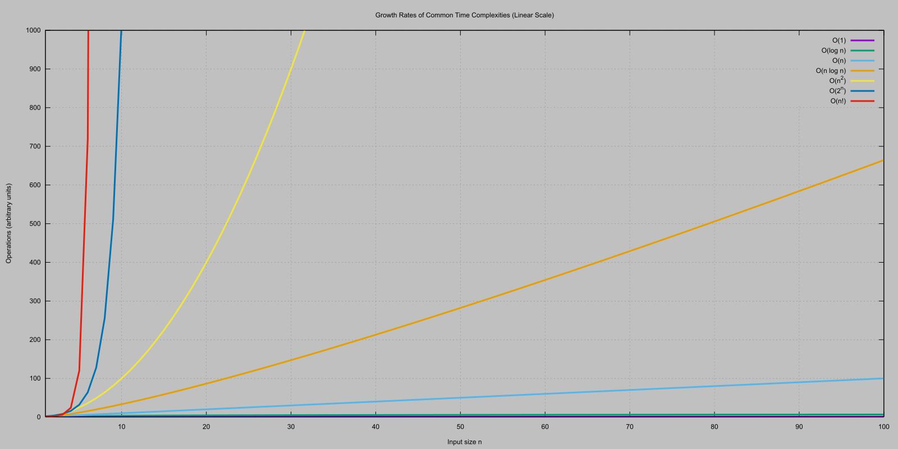
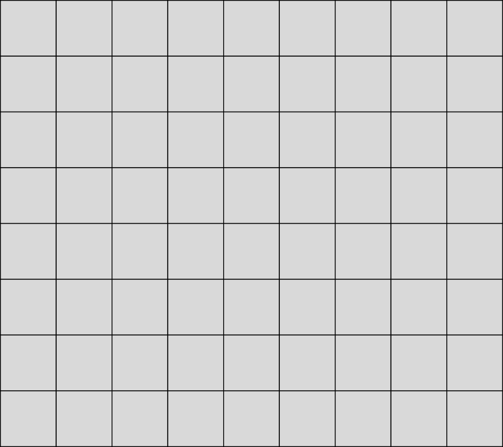
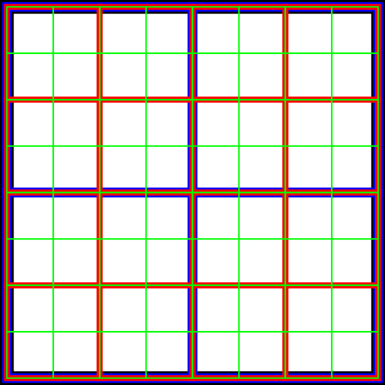
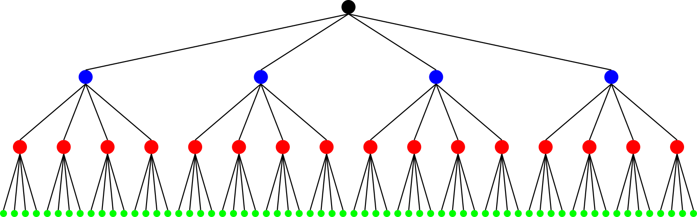
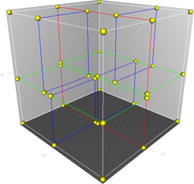
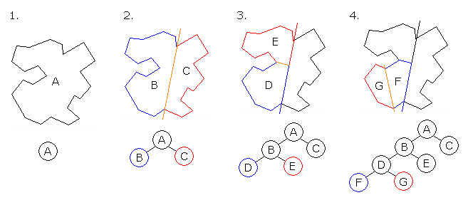
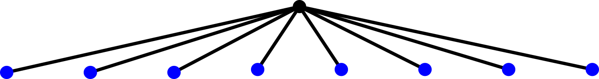
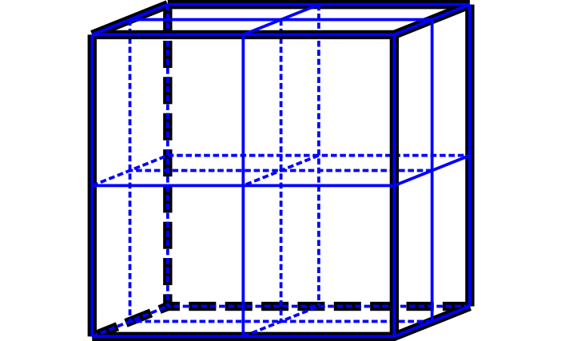

# Introduction

---

## Previously

- Pixel perfect collisions
- Bullet & explosions
- Pathfinding

---

## Today

- Space indexing
- Space partitioning
- Traditional quad tree
- Game use quad tree

---

# Introduction to space partitioning

---

## What is space partitioning?

- Divide the game world into smaller spatial regions.
- Organise objects according to their position.
- Quickly identify nearby objects.
- Avoid checking every object against every other object.

---

## The problem: too many objects

- Imagine a world containing 1,000 entities.
- Naive collision detection compares every pair.
- Number of comparisons: $N \times (N - 1) / 2$.
- 1000 objects = 499500 comparisons.

---

## Questions

> Is $N \times (N - 1) / 2$ good?

> Do we need to do all those comparisons?

---



---

## The basic idea

- Most objects are far away from each other.
- Distant objects cannot collide.
- Only compare objects occupying nearby regions.
- Spatial organisation reduces unnecessary work.

---

## Space partitioning is not just for collisions

- Collision detection.
- Neighbour searches.
- Proximity-based AI.
- Area-of-effect attacks.
- Visibility and rendering.
- Particle and entity management.

---

## The fundamental trade-off

- Smaller regions: more precise spatial queries.
- Larger regions: fewer regions to manage.
- Complex structures: faster queries, more maintenance.
- No single algorithm is best for every game.

---

# Uniform spatial grid

---

## Uniform grid: the principle

- Divide the world into equally sized cells.
- Assign each object to one or more cells.
- Objects in neighbouring cells become potential candidates.
- Ignore objects in distant cells.

---

## Uniform grid



---

## Mapping coordinates to cells

- Each cell has a fixed width and height.
- Convert world coordinates into grid coordinates.
- Divide the position by cell dimensions.
- Use integer conversion to obtain cell indices.

```cpp
int cellX = (int)(position.x / cellWidth);
int cellY = (int)(position.y / cellHeight);
```

- Cell coordinates are not world coordinates.

---

## Representing the grid

- Use a 2D array of cells.
- Each cell stores references to entities.
- Alternatively, use a hash map for an unbounded world.
- Store pointers or entity identifiers, not copies.

```cpp
struct Cell {
    std::vector<Entity*> entities;
};
```

---

## Inserting objects

- Calculate the object's cell coordinates.
- Insert its reference into that cell.
- Repeat for every object.
- Update membership when objects move.

```cpp
grid[cellY][cellX].entities.push_back(entity);
```

---

## What about large objects?

- An object may overlap several cells.
- Insert it into every cell it overlaps.
- Alternatively, assign it to one cell and perform additional checks.
- Avoid missing collisions across cell boundaries.

---

## Querying nearby objects

- Identify the cells surrounding an object.
- Retrieve their entity references.
- Perform precise collision checks on candidates.
- Remove duplicate candidates when necessary.

---

## Choosing cell size

- Large cells: more objects per cell.
- Small cells: more cells to inspect.
- Consider typical object dimensions.
- Consider object density and movement speed.
- Test different configurations.

---

## Grid complexity

- Insertion: typically $O(1)$.
- Removal: typically $O(1)$ with suitable bookkeeping.
- Query: depends on the number of inspected cells and candidates.
- Worst case: all objects occupy the same cell.

**Important:** A grid improves average performance, not necessarily worst-case performance.

---

# Spatial hashing

---

## Why spatial hashing?

- A traditional grid requires a defined world size.
- Large worlds can require many empty cells.
- Spatial hashing stores only occupied cells.
- Useful for large or effectively infinite worlds.

---

## How spatial hashing works

- Convert cell coordinates into a hash value.
- Use the hash as a key in a hash map.
- Store the cell's entities under that key.
- Empty cells need no storage.

```cpp
std::unordered_map<int, Cell> cells;
```

[[***Link***]{.underline}](https://en.cppreference.com/cpp/container/unordered_map)

---

## Hash collisions

- Different cells can produce the same hash value.
- A hash collision is not a spatial collision.
- The data structure must distinguish different cell coordinates.
- Use a suitable key or handle collisions correctly.

---

## Grid vs spatial hashing

- Grid: simple, predictable, fixed world.
- Spatial hash: flexible, sparse worlds.
- Both use the same spatial subdivision principle.
- Both can suffer when too many objects occupy one cell.

---

# Quadtrees

---

## The problem with uniform grids

- Some regions contain many objects.
- Other regions contain very few.
- Uniform grids allocate the same spatial resolution everywhere.
- Can we subdivide only busy regions?

---

## Quadtree: the principle

- Start with one large region.
- Divide it into four equally sized regions.
- Subdivide regions when they become too populated.
- Continue until a limit is reached.

---



---



---

## Quadtree structure

- Each node represents a rectangular region.
- Each node has up to four children.
- Leaf nodes store objects.
- Internal nodes organise space.

```cpp
struct QuadTree {
    Rectangle bounds;
    std::vector<Entity*> entities;

    QuadTree* children[4];
};
```

---

## When do we subdivide?

- Define a maximum number of objects per node.
- Define a maximum tree depth.
- Subdivide when capacity is exceeded.
- Redistribute objects into children.

---

## Inserting into a quadtree

- Check whether the object overlaps the node.
- If the node is a leaf, insert the object.
- If capacity is exceeded, subdivide.
- Otherwise, insert into the appropriate child.

---

## Querying a quadtree

- Start at the root.
- Ignore nodes that do not overlap the query area.
- *Recursively* inspect relevant children.
- Collect objects from intersecting nodes.

---

## Objects crossing boundaries

- Objects can overlap multiple child regions.
- Store them in the parent when they do not fit inside one child.
- Alternatively, duplicate references across children.
- Avoid missing objects during queries.

---

## Quadtree performance

- Adapts to uneven object distributions.
- Can reduce the number of inspected objects.
- Requires more complex insertion and removal.
- Tree maintenance can become expensive.
- Worst case can still approach $O(N)$.

[[***Demo***]{.underline}](https://hypersphere.blog/demo/quadtree/)

---

## Terminology

- **Node** - a point on a tree
- **Leaf Node** - a point on a tree which has no children
- **Bucket** - an unorganised collection of items
- **Entity** - the lowest level item in our world we wish to index.
- It could be a whole world entity or part of one

---

## Original

- The original quad tree has several features
  - Only leaf nodes contain entities
  - It has a maximum number of entities per leaf
- To add to the tree
  - Start with just a root node
  - Loop through all entities
    - Place the entity in the tree node at the lowest level
    - If the max entities per node is reached divide the area into four and
      place the entities in the correct quadrant.
    - We may need to do this a few times until there is less than the max
      number of entities per node
  - At the end go through the whole tree pruning leaf nodes that do not
    contain entities (for an adaptive quad tree)

---

## Original

- Setting a max number per node can cause problems if entities overlap
- so, subdividing the space does not reduce the number of entities per node
- Note: we could just hold one entity per leaf node
- Useful for image representation (per pixel)

---

## For our uses

- For games we may want to use quad trees to
   1. Reduce the number of entities we attempt to render
   2. Reduce collision detection tests
- For 1) we could create a fixed quadtree at level load (or even in advance)
  just for non-dynamic entities
- Where we want to handle dynamic data:
  - Entities can move and so we need to be able to quickly insert them into
    the tree
  - We could do this dynamically with the traditional approach at run time,
    but it could be slow

---

## Game Use

- Requirements:
  - We do not want to be doing dynamic tree building during our game loop if
    possible
  - We want to be able to specify a maximum tree depth
  - We may or may not be able to have a fixed size bucket for each cell
    (depends on the game) but we would like it to be fixed
  - Due to varying sizes of entities in a game we do not want to restrict
    ourselves to only storing entities in leaf nodes
  - We want to be able to quickly assemble a list of all entities within an
    area
- Note: experimentation is needed to find the most effective depth and bucket
  size

---

## Building the tree

- The first step is to build our fixed size tree
- We are going to need to define a node

---

## Tree Node

- Each node in our quad tree will need:
- A reference to 4 other nodes
  - Could be a pointer or index etc.
- A bucket of entities
  - You could create an interface class specifically to add into the quad tree
    or use an 'entity' base class.
  - What are the advantages of using an interface class?
    - We could add other items apart from just entities
    - Makes our tree more flexible and self-contained
    - `*Entities` being the smallest thing you wish to index

---

## Tree Node

- An initial structure

```cpp
struct Node {
  Node *ne,*nw,*se,*sw;
  Bucket *entityBucket;
};
```

---

## Tree Node

- The bucket itself (if not a fixed size) needs to be able to grow and shrink
  - When removing an item, we need to find it quickly
- A linked list is a possible choice

---

## Building

- We specify our start area of space  e.g. 1024 wide (`x`) by 1024 high (`y`)
- We create a function that will take a region and break it into 4,
  creating 4 new nodes
- We will call this function recursively until we have reached the maximum
  depth or our tree

---

## Building

- E.g. 0-1023,0-1023 is the root area split into
  - NW: (0-511,0-511)
  - NE:(512-1023,0-511)
  - SW: (0-512, 512-1023)
  - SE: (512-1023, 512-1023)
- This counts as one level
- For each of these nodes split again until we have reached the required
  number of levels

---

## Building

- We could just store all our nodes in one long array and rather than use
  pointers use index look ups
- To calculate the size of the array needed:
  - Each level of the tree has 4 times the number of nodes as the previous one
  - The first level has 1 (the root)
  - The second has 4
  - The third has 16
  - The fourth 64 etc.

---

## Node Again

- While it is possible to calculate a nodes bounding area when traversing the
  tree it is often faster and easier to just store the area in the node

```cpp
typedef Node {
  Vector2 boundingCoordinates[4]; // min, max in x and z
  int ne, nw, se, sw;
  // indexes into the node array
  Bucket *entityBucket;
  int parent; // also helpful
};
```

---

## Inserting

- To insert entities into our built tree we start at the root and then:
  1. See if the entity is completely contained by the node region
  2. If it is loop to 1 with each child node until the entity no longer fits
  completely into the node region
  3. Add the entity to the bucket of the node that was the last ont to
  completely contain the entity
- With dynamic objects this will need to be carried out each time they move
- Note: advanced implementations may have entities to be sorted in the cell

---

## Search

- For collision use we could determine which entities to test by doing a
  search on a distance value. Here: 5.
- If NE node is not empty
  - If (closest point from NE node is closer than 5 units)
     - Check for collision using the entities in this node and recurse with
       child nodes
- If NW node is not empty
  - If (closest point from NW node is closer than 5 units)
     - Check for collision using the entities in this node and recurse with
       child nodes
- If SE node is not empty
  - If (closest point from SE node is closer than 5 units)
     - Check for collision using the entities in this node and recurse with
       child nodes
- If SW node is not empty
  - If (closest point from SW node is closer than 5 units)
     - Check for collision using the entities in this node and recurse with
       child nodes

---

## Search

- Once we have determined the region of space, we wish to include in our
  search... e.g.
  - It could be a view frustum
  - It could be a fixed area (e.g. defined by an entities bounding circle /
    rectangle)
- ...we can use our tree to cull entities that are not in that region of space
- We do this by traversing the tree and ignoring all nodes whose regions do
  not cross the region in question
- We add all the entities found to a 'found list'
  - Again this is best as a fixed size array but alternatively you can just
    switch on or off a flag in the entity itself

---

# Other spatial partitioning algorithms

---

## Octree

- Equivalent to quadtrees but we divide each node in 8 sub-nodes.
- Easy to think about using for 3d, but not only.

---

## K-D trees

- Recursively split space using a single axis.
- Alternate between horizontal and vertical splits in 2D.
- Can support efficient nearest-neighbour searches.
- Useful for static spatial data.

---



---

## Bounding volume hierarchies (BVH)

- Organise objects inside bounding volumes.
- Each parent contains the bounds of its children.
- Query parent bounds before inspecting children.
- Useful for collision detection.

---

## Binary Space Partitioning (BSP)



---

## Sweep and prune

- Sort objects along one axis.
- Compare overlapping intervals.
- Only test pairs that overlap on the chosen axis.
- Often useful for broad-phase collision detection.

---

## Comparing the algorithms

| Algorithm       | Main advantage                 | Main disadvantage |
| ---             | ---                            | ---               |
| Uniform Grid    | Simple and fast                | Fixed resolution  |
| Spatial Hash    | Sparse, large worlds           | Hash management   |
| Quadtree        | Adaptive subdivision           | Complex updates   |
| K-D Tree        | Spatial queries                | Dynamic updates   |
| BVH             | Hierarchical collision queries | Maintenance       |
| BSP             | BSP collisions (Quake)         | Dynamic updates   |
| Sweep And Prune | Efficient overlap filtering    | Sorting overhead  |

---

# Static vs dynamic worlds

---

## Static and dynamic objects

- Static objects rarely or never move.
- Dynamic objects move every frame.
- Maintaining one structure for everything can be expensive.
- Consider separate spatial structures.

---

## Updating spatial data

- Remove an entity from its previous cell.
- Calculate its new spatial position.
- Insert it into the new cell.
- Avoid unnecessary updates when it stays in the same cell.
- Incremental: update only objects that move.
- Rebuilding: recreate the structure every frame.
- Rebuilding can be simpler for highly dynamic scenes.
- Incremental updates can be cheaper for mostly static scenes.

---

## Broad phase and narrow phase

- Broad phase: find potential collisions.
- Narrow phase: perform precise collision tests.

---

# Extension to 3d games

---

## From 2d to 3d

- 2D space uses X and Y coordinates.
- 3D space adds the Z coordinate.
- Spatial partitioning principles remain identical.
- Data structures and subdivision rules change.

---

## Octrees

- Equivalent to quadtrees in 3D.
- Each node subdivides into eight children.
- Useful for organising 3D environments.
- Can support collision and visibility queries.



---



---

## 3d spatial structures

- Uniform 3D grids.
- 3D spatial hashing.
- Octrees.
- 3D BVHs.
- K-D trees.

---

## 2d vs 3d: practical differences

- More dimensions mean more spatial regions.
- A quadtree has four children; an octree has eight.
- Bounding volumes become boxes instead of rectangles.
- Spatial queries become more expensive.
- Memory and subdivision strategies become more important.
- Octrees available in Irrlicht and OGRE.

---

# Implementation in our game engine

---

## Designing a reusable interface

- Avoid coupling spatial partitioning to SFML.
- The engine should own the spatial data structure.
- Entities provide their spatial bounds.
- Allow different partitioning implementations.

```cpp
class ISpatialPartition {
public:
    virtual void insert(Entity* entity) = 0;
    virtual void remove(Entity* entity) = 0;
    virtual std::vector<Entity*> query(
        const sf::FloatRect& area
    ) = 0;
    virtual ~ISpatialPartition() = default;
};
```

---

## Integrating with the engine

- Update entity positions.
- Update spatial membership.
- Query nearby entities.
- Perform collision checks on candidates.
- Keep rendering independent of the spatial structure.

---

## What should we implement?

- Start with a uniform grid.
- Support insertion, removal and spatial queries.
- Handle entities overlapping multiple cells.
- Integrate with the collision broad phase.
- Measure performance before adding complexity.

---

## Testing performance

- Create scenes with different entity counts.
- Compare naive collision detection against a grid.
- Test uniform and highly concentrated distributions.
- Measure insertion, update and query times.
- Count candidate pairs and actual collisions.

---

## Common mistakes

- Choosing inappropriate cell sizes.
- Forgetting objects can overlap multiple cells.
- Failing to remove stale references.
- Returning duplicate query results.
- Ignoring world boundaries.
- Assuming spatial partitioning always improves performance.

---

# So...

---

## What have we learned?

- Spatial partitioning organises objects by location.
- It reduces unnecessary spatial queries.
- Grids are simple and effective.
- Quadtrees adapt to uneven distributions.
- Hashing supports large sparse worlds.
- BVHs and other structures solve different problems.

---

## Final design question

**Which algorithm should our game engine use?**

- Small, regular worlds: Uniform Grid.
- Large, sparse worlds: Spatial Hash.
- Uneven object distributions: Quadtree.
- Hierarchical collision queries: BVH.
- Static spatial data: K-D Tree.

**The best choice depends on the game, not the algorithm's theoretical complexity alone.**

---

# Conclusion

---

## We discussed

- Space Indexing
- Space Partitioning
- Traditional Quad Tree
- Game use Quad Tree

---

## Next time

- More and recap
- Milestone 3
- Animex
- Physics

---

## Any questions?

**Tutor**: Julien Cordry

**Email**: j.cordry@tees.ac.uk

**Office**: G0.46B

See Blackboard for online materials:
[***https://bb.tees.ac.uk***](https://bb.tees.ac.uk)
