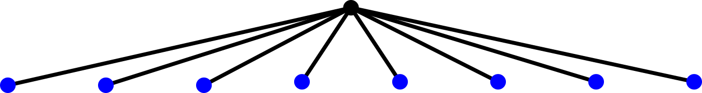
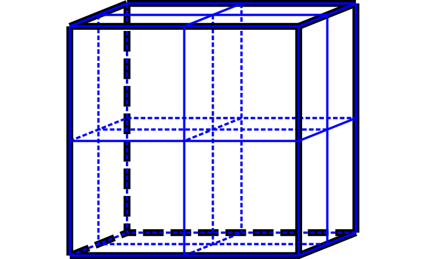
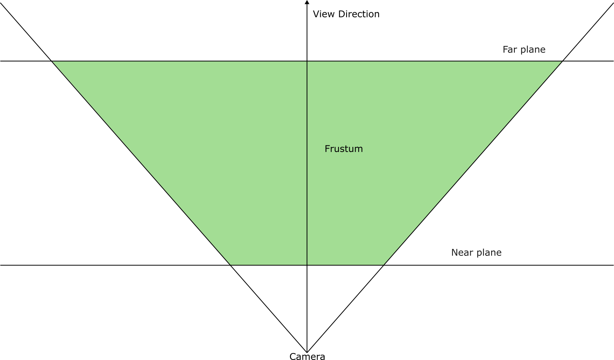
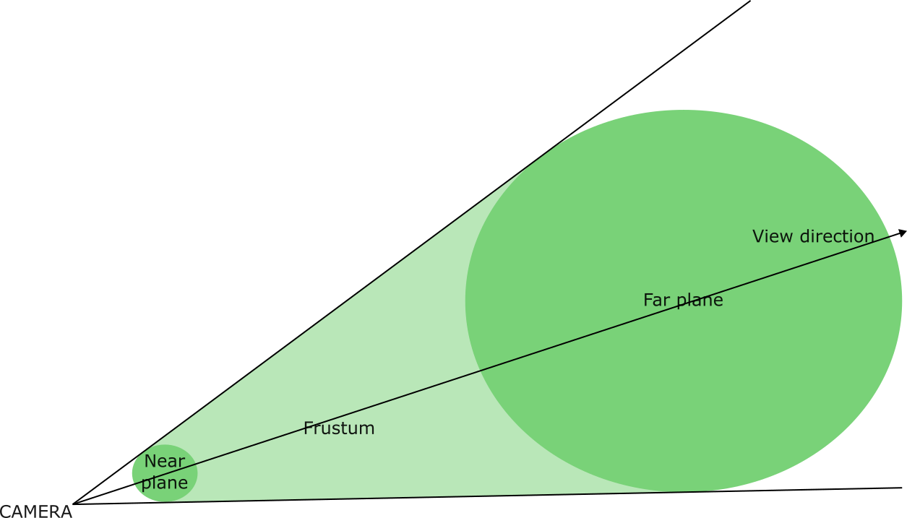
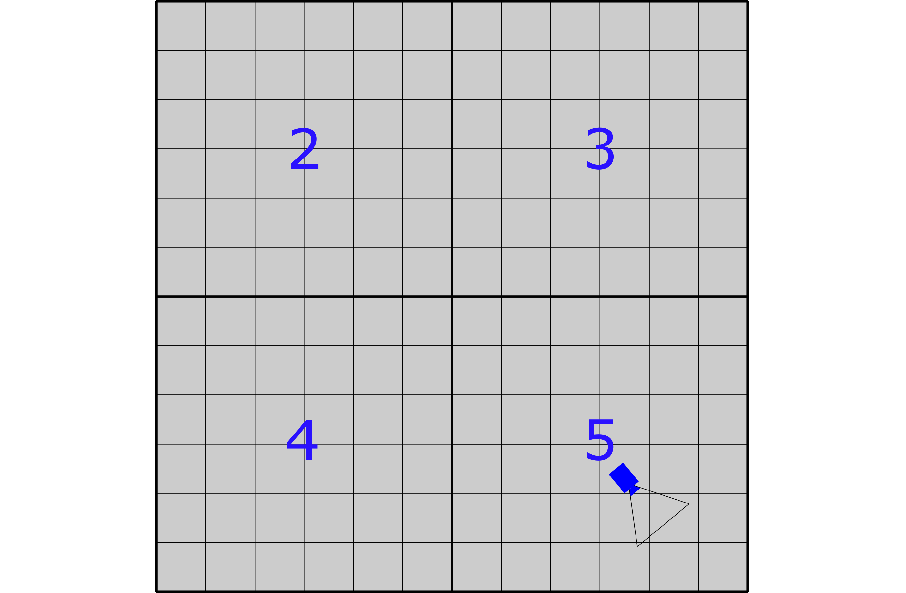
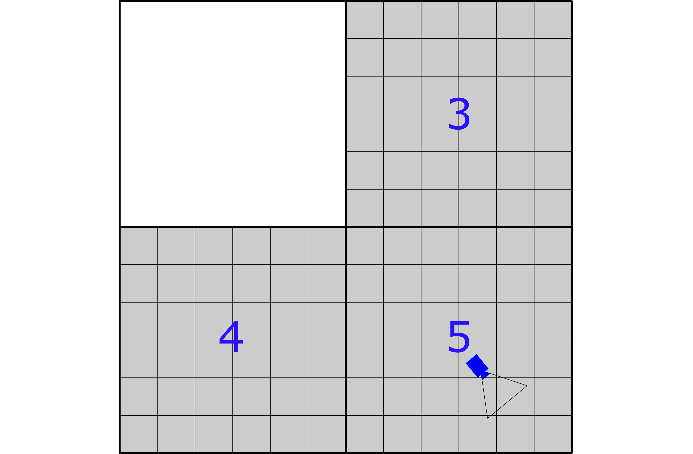
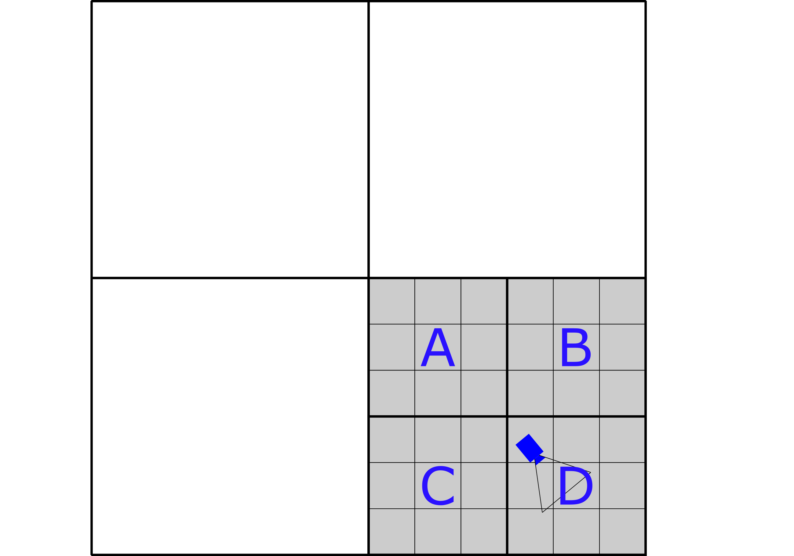
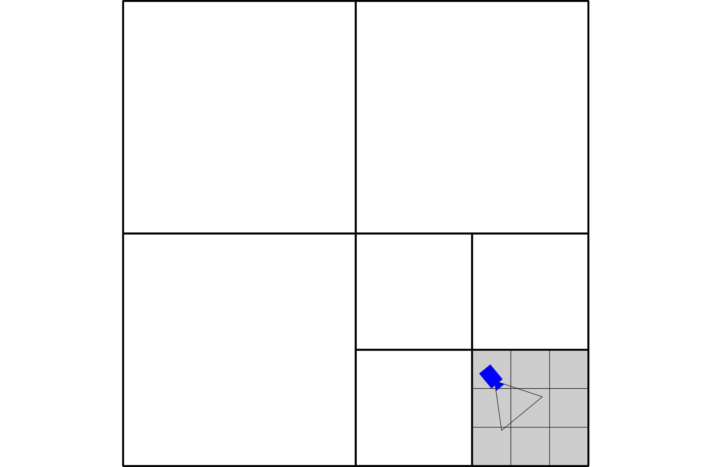

# Introduction

---

## Previously

- Pixel perfect collisions.
- Bullets and explosions.
- Pathfinding.
- Space partitioning.

---

## Today

- Quadtrees
- Other types of space partitioning
- $A^{\star}$ improvements

---

# Static vs dynamic worlds

---

## Static and dynamic objects

- Static objects rarely or never move.
- Dynamic objects move every frame.
- Maintaining one structure for everything can be expensive.
- Consider separate spatial structures.

---

## Updating spatial data

- Remove an entity from its previous cell.
- Calculate its new spatial position.
- Insert it into the new cell.
- Avoid unnecessary updates when it stays in the same cell.
- Incremental: update only objects that move.
- Rebuilding: recreate the structure every frame.
- Rebuilding can be simpler for highly dynamic scenes.
- Incremental updates can be cheaper for mostly static scenes.

---

## Broad phase and narrow phase

- Broad phase: find potential collisions.
- Narrow phase: perform precise collision tests.

---

# Extension to 3d games

---

## From 2d to 3d

- 2D space uses X and Y coordinates.
- 3D space adds the Z coordinate.
- Spatial partitioning principles remain identical.
- Data structures and subdivision rules change.

---

## Octrees

- Equivalent to quadtrees in 3D.
- Each node subdivides into eight children.
- Useful for organising 3D environments.
- Can support collision and visibility queries.



---



---

## 3d spatial structures

- Uniform 3D grids.
- 3D spatial hashing.
- Octrees.
- 3D BVHs.
- K-D trees.

---

## 2d vs 3d: practical differences

- More dimensions mean more spatial regions.
- A quadtree has four children; an octree has eight.
- Bounding volumes become boxes instead of rectangles.
- Spatial queries become more expensive.
- Memory and subdivision strategies become more important.
- Octrees available in Irrlicht and OGRE.

---

# Implementation in our game engine

---

## Designing a reusable interface

- Avoid coupling spatial partitioning to SFML.
- The engine should own the spatial data structure.
- Entities provide their spatial bounds.
- Allow different partitioning implementations.

```cpp
class ISpatialPartition {
public:
    virtual void insert(Entity* entity) = 0;
    virtual void remove(Entity* entity) = 0;
    virtual std::vector<Entity*> query(
        const sf::FloatRect& area
    ) = 0;
    virtual ~ISpatialPartition() = default;
};
```

---

## Integrating with the engine

- Update entity positions.
- Update spatial membership.
- Query nearby entities.
- Perform collision checks on candidates.
- Keep rendering independent of the spatial structure.

---

## What should we implement?

- Start with a uniform grid.
- Support insertion, removal and spatial queries.
- Handle entities overlapping multiple cells.
- Integrate with the collision broad phase.
- Measure performance before adding complexity.

---

## Testing performance

- Create scenes with different entity counts.
- Compare naive collision detection against a grid.
- Test uniform and highly concentrated distributions.
- Measure insertion, update and query times.
- Count candidate pairs and actual collisions.

---

## Common mistakes

- Choosing inappropriate cell sizes.
- Forgetting objects can overlap multiple cells.
- Failing to remove stale references.
- Returning duplicate query results.
- Ignoring world boundaries.
- Assuming spatial partitioning always improves performance.

---

# So...

---

## What have we learned?

- Spatial partitioning organises objects by location.
- It reduces unnecessary spatial queries.
- Grids are simple and effective.
- Quadtrees adapt to uneven distributions.
- Hashing supports large sparse worlds.
- BVHs and other structures solve different problems.

---

## Final design question

**Which algorithm should our game engine use?**

- Small, regular worlds: Uniform Grid.
- Large, sparse worlds: Spatial Hash.
- Uneven object distributions: Quadtree.
- Hierarchical collision queries: BVH.
- Static spatial data: K-D Tree.

**The best choice depends on the game, not the algorithm's theoretical complexity alone.**

---

## Frustum



---

## Frustum



---



---

## Example

###  Given the following situation:

- Ask: is the camera within the bounding area of node 2?
- No, so we can can discard one whole quadrant:

---



---

- Also test with 3,4 and 5
- Not in 3 and 4 but yes it is in 5

---



---

## Example

- Now we test node 5s children (A,B,C,D)

---



---

## Example

- Testing all the children we get
- Now check node Ds children etc.
  - We can stop when we reach the bottom of the tree or the node area does not fully enclose the camera frustum

---

## Another good use case

- A limiting factor in networked games is bandwidth.
- When playing a game with multiple other players, everyone needs to know what every other player is doing.
  - What do we do about AI managed units, physics...
- We need to send a massive amount of messages and receive even more.
- This takes resources away from actually playing the game.
- ***Space partitioning** will help us limit the number of messages* that do need to be sent and therefore squash down bandwidth requirements.
  - Limit what we need to know from players that are far away on the map.

---

# Shared Pointers

---

## Memory leaks!

- It is easy to forget to delete memory leading to leaks  Windows will clean
  up after your program but if you are leaking regularly e.g., per level load,
  it can cause issues
- When you copy pointers to memory it is tricky to organise who is responsible for deleting them.
- If you try to delete something twice you get a crash

---

## Why memory management matters

- Game engines create and destroy many objects.
- Who is responsible for deleting an object?
- What happens when an object is deleted twice?
- What happens when nobody deletes it?

**Key problem:** Managing object lifetime manually is error-prone.

---

## Manual memory management

```cpp
Enemy* enemy = new Enemy();

// Use enemy

delete enemy;
```

- `new` allocates memory on the heap.
- `delete` releases that memory.
- Forgetting `delete` causes a memory leak.
- Deleting twice causes undefined behaviour.
- Using a deleted pointer causes undefined behaviour.

**Problem:** The programmer must track ownership manually.

---

## What is a smart pointer?

- A smart pointer is an object that manages a raw pointer.
- It controls the lifetime of dynamically allocated objects.
- It automatically releases memory when appropriate.
- It uses RAII (Resource Acquisition Is Initialization).

```cpp
std::unique_ptr<Enemy> enemy =
    std::make_unique<Enemy>();
```

No explicit `delete` required!

---

## Include the memory header

```cpp
#include <memory>
```

Three important smart pointers:

- `std::unique_ptr`
- `std::shared_ptr`
- `std::weak_ptr`

Each represents a different ownership model.

---

## `std::unique_ptr`

Recommended default

- Owns an object exclusively.
- Only one `unique_ptr` owns the object.
- Automatically destroys the object when it goes out of scope.
- Cannot be copied.

```cpp
std::unique_ptr<Enemy> enemy =
    std::make_unique<Enemy>();
```

**Ownership:** One owner, one lifetime.

---

## Transferring ownership

Ownership can be transferred using `std::move`.

```cpp
std::unique_ptr<Enemy> enemy1 =
    std::make_unique<Enemy>();

std::unique_ptr<Enemy> enemy2 =
    std::move(enemy1);
```

- `enemy2` now owns the object.
- `enemy1` becomes empty (`nullptr`).
- There is still only one owner.

**Important:** Moving is not copying.

---

## Using unique pointers in a game engine

Consider an entity manager:

```cpp
class EntityManager
{
    std::vector<std::unique_ptr<Entity>> entities;

public:
    void addEntity(std::unique_ptr<Entity> entity)
    {
        entities.push_back(std::move(entity));
    }
};
```

---

Creating an entity:

```cpp
manager.addEntity(
    std::make_unique<Enemy>()
);
```

- The manager owns its entities.
- Entities are automatically destroyed with the manager.
- Clear ownership and predictable lifetime.

**Useful for:** Entities, enemies, projectiles and game objects.

---

## Accessing the object

A smart pointer behaves similarly to a raw pointer.

```cpp
std::unique_ptr<Enemy> enemy =
    std::make_unique<Enemy>();

enemy->update();
```

Other useful operations:

```cpp
enemy.get();      // Access raw pointer
enemy.reset();    // Destroy owned object
enemy = nullptr;  // Release ownership
```

Avoid using `.get()` to take ownership or call `delete`.

---

## `std::shared_ptr`

Use when shared ownership is needed

- Multiple pointers can own the same object.
- The object is destroyed when the last owner disappears.
- Uses reference counting.

```cpp
auto texture = std::make_shared<sf::Texture>();
```

Sharing ownership:

```cpp
auto texture2 = texture;
```

Both pointers now own the same texture.

---

## Reference counting

Each `shared_ptr` maintains a reference count.

```cpp
auto a = std::make_shared<Enemy>();
auto b = a;
auto c = a;
// Reference count: 3
```

When a pointer disappears:

- Reference count decreases.
- When it reaches zero, the object is destroyed.

**Trade-off:**

- Convenient shared ownership.
- Additional memory and runtime overhead.
- Lifetime becomes less explicit.

---

## Shared resources in SFML

Imagine several sprites using the same texture.

```cpp
using TexturePtr =
    std::shared_ptr<sf::Texture>;

class SpriteEntity
{
    TexturePtr texture;

public:
    SpriteEntity(TexturePtr tex)
        : texture(tex)
    {
    }
};
```

---

Creating shared ownership:

```cpp
auto texture =
    std::make_shared<sf::Texture>();

SpriteEntity player(texture);
SpriteEntity enemy(texture);
```

- Both entities share the texture.
- The texture remains alive while either entity owns it.

**Potential use:** Shared resources with independent lifetimes.

---

## The problem with shared ownership

Circular references can prevent objects from being destroyed.

For example:

- Object A owns Object B.
- Object B owns Object A.
- Both reference counts remain above zero.
- Neither object is destroyed.

**Solution:** Use `std::weak_ptr` when ownership is not required.

---

## std::weak_ptr

- Observes an object managed by `shared_ptr`.
- Does not increase the reference count.
- Does not keep the object alive.
- Useful for breaking ownership cycles.

```cpp
std::shared_ptr<Enemy> enemy =
    std::make_shared<Enemy>();

std::weak_ptr<Enemy> observer = enemy;
```

The weak pointer does not own the enemy.

---

## Checking if an object still exists

A weak pointer must be converted into a shared pointer before accessing the object.

```cpp
if (auto ptr = observer.lock())
{
    ptr->update();
}
```

- `lock()` returns a `shared_ptr` if the object exists.
- Otherwise, it returns an empty pointer.

**Useful for:** Observing objects without controlling their lifetime.

---

## Comparing smart pointers

| Feature               | `unique_ptr` | `shared_ptr`       | `weak_ptr` |
| --------------------- | ----------   | ----------------   | ---------  |
| Ownership             | Exclusive    | Shared             | None       |
| Copyable              | No           | Yes                | Yes        |
| Automatic destruction | Yes          | Yes                | No         |
| Reference counting    | No           | Yes                | Observes   |
| Typical use           | Entities     | Shared resources   | Observers  |

**Rule of thumb:**

- Start with `unique_ptr`.
- Use `shared_ptr` only when shared ownership is necessary.
- Use `weak_ptr` to observe shared objects without owning them.

---

## Smart pointers vs raw pointers

Raw pointers are not necessarily bad.

Use raw pointers when:

- You need to access an object without owning it.
- Another system clearly manages its lifetime.
- You do not need to transfer ownership.

---

## Example

```cpp
class CollisionSystem
{
public:
    void checkCollision(Entity* a, Entity* b);
};
```

The collision system uses the entities but does not own them.

**Important:** A raw pointer does not guarantee that the object is still alive.

---

## What about SFML objects?

SFML already uses RAII for many of its resources.

For example:

```cpp
sf::Texture texture;
sf::Sprite sprite;

sprite.setTexture(texture);
```

---

You do not need a smart pointer just because an object uses the heap or manages a resource.

Consider:

- Does the object need dynamic allocation?
- Who owns it?
- Does it need to outlive its current scope?

**Prefer stack allocation when possible.**

---

## Common mistakes

Avoid these practices:

- Using `shared_ptr` everywhere.
- Creating unnecessary dynamic allocations.
- Mixing manual `delete` with smart pointer ownership.
- Returning raw pointers without considering lifetime.
- Creating circular `shared_ptr` references.

**Remember:** Smart pointers solve ownership problems, not every memory management problem.

---

1. Smart pointers automate object lifetime management.
1. `unique_ptr` should be the default for dynamically allocated objects.
1. `shared_ptr` is useful when multiple systems genuinely share ownership.
1. `weak_ptr` provides observation without ownership.
1. Raw pointers remain useful for non-owning access.
1. Good engine architecture starts by defining who owns each object.

**A better question is not which pointer to use, but who is
responsible for the object's lifetime.**

---

# Improving basic $A^{\star}$

---

## $A^{\star}$ Improvements

- Some issues with $A^{\star}$ are
  - Right angle turns rather than 'smooth' paths
  - Going up against obstacles
- Interesting papers on solving these (mainly created from robot
  requirements):
  - [[***https://pmc.ncbi.nlm.nih.gov/articles/PMC8853577/***]{.underline}](https://pmc.ncbi.nlm.nih.gov/articles/PMC8853577/)
  - Searches both from start to end and end to start and connects
  - Uses Bezier curves to smooth the path
  - $\Theta^{\star}$ (theta star) handles smoothing the route by using line of
    sight:
      - [[***https://news.movel.ai/theta-star?x-host=news.movel.ai***]{.underline}](https://news.movel.ai/theta-star?x-host=news.movel.ai)
- Can also divide large maps into areas / chunks

---

## RTS

- For an RTS style game we will need
  - A map made up of a grid of tiles
    - Each tile can store temporary search values as well as game data
      `cost_so_far`, `came_from`
  - A search algorithm that can return a path
  - Each entity can then query the search algorithm to get its best path
- Advanced: how do you handle moving units or people building walls?
  - We could keep recalculating the path but that may be expensive
  - We could use the idea of zones

---

## Links

- Amit Patel (ex Stanford student) has a lot of very good material on his Red
  Blob Games site and on the Stanford site:
- A great description of the algorithms along with interactive maps
  [[***http://www.redblobgames.com/pathfinding/a-star/introduction.html***]{.underline}](http://www.redblobgames.com/pathfinding/a-star/introduction.html)
- A discussion on choosing the best heuristic:
  [[***http://theory.stanford.edu/~amitp/GameProgramming/Heuristics.html***]{.underline}](http://theory.stanford.edu/~amitp/GameProgramming/Heuristics.html)
- A discussion on various methods used by games:
  [[***https://news.ycombinator.com/item?id=34594547***]{.underline}](https://news.ycombinator.com/item?id=34594547)
- Left 4 Dead approach :
  [[***https://steamcdn-a.akamaihd.net/apps/valve/2009/ai_systems_of_l4d_mike_booth.pdf***]{.underline}](https://steamcdn-a.akamaihd.net/apps/valve/2009/ai_systems_of_l4d_mike_booth.pdf)
- Factorio:
  [[***https://factorio.com/blog/post/fff-317***]{.underline}](https://factorio.com/blog/post/fff-317)

---

# Milestones deadlines

---

# Conclusion

---

## We discussed

- Quadtrees
- Other types of space partitioning
- $A^{\star}$ improvements

---

## Next time

- Animex
- Physics

---

## Any questions?

**Tutor**: Julien Cordry

**Email**: [[***j.cordry@tees.ac.uk***]{.underline}](mailto:j.cordry@tees.ac.uk)

**Office**: G0.46B

See Blackboard for online materials:
[[***https://bb.tees.ac.uk***]{.underline}](https://bb.tees.ac.uk)
